# selfkraken

[](https://github.com/x3beche/selfkraken/actions/workflows/ci.yml)
[](https://github.com/x3beche/selfkraken/releases/latest)
[](LICENSE)
[](pyproject.toml)

A private, single-user, repository-local Git assistant — a personal replacement
for GitKraken's core loop:

**register a repo → index it → ask one model for a change → get a unified diff
proposal → review → apply → run tests → keep or roll back → every step recorded
in SQLite.**

Python 3.12 + Typer + SQLite. Small, local, honest.

## Install

Everything is built by CI and attached to
[the latest release](https://github.com/x3beche/selfkraken/releases/latest)
(`SHA256SUMS` included):

| What | File | Needs |
| --- | --- | --- |
| Python package (all OSes) | `selfkraken-0.1.1-py3-none-any.whl` | Python 3.12 |
| Standalone CLI | `skraken-linux-x86_64`, `skraken-macos-{arm64,x86_64}`, `skraken-windows-x86_64.exe` | nothing |
| Desktop app (Qt + Monaco) | `skraken-gui-<os>-<arch>.{tar.gz,zip}` | nothing; Linux wants `libnss3`, `libxkbcommon0`, `libegl1` |

```bash
# CLI, no Python needed
chmod +x skraken-linux-x86_64 && ./skraken-linux-x86_64 doctor

# the desktop build is both: no flag opens the window, -c runs the CLI
./skraken-gui/skraken-gui                    # window
./skraken-gui/skraken-gui -c doctor          # same as `skraken doctor`
./skraken-gui/skraken-gui -c graph --repo .  # any command, any flag

# or the package
pip install selfkraken-0.1.1-py3-none-any.whl   # add [gui] extra for the desktop app
skraken doctor
```

Binaries are unsigned: macOS may need `xattr -dr com.apple.quarantine skraken-*`
after unpacking. The standalone CLI is core-only — `skraken gui` still needs the
GUI build or the `[gui]` extra. Bundled third-party licences: [THIRD_PARTY.md](THIRD_PARTY.md).

## What it is — and what it is not

It **is**: a command-line tool that keeps an index of your repo, asks one
configurable OpenAI-compatible model for a change as a unified diff, applies
that diff with `git apply`, runs your test command, and records every proposal,
apply, test run and rollback in a local database.

It is **not**:

- **not frontier-model quality.** Output quality is whatever your chosen model
  gives you, with the same limits it has.
- **not large-context infrastructure.** It sends at most `SK_MAX_CONTEXT_CHARS`
  of repo snippets per request. There is no embedding pipeline, no RAG platform.
- **not an IDE.** No editing, no plugins, no sub-100ms autocomplete loop.
  There is a native desktop GUI (`skraken gui`, see below) for the core loop —
  review, apply, test, keep or roll back — and it shows code in the VS Code
  editor (Monaco, read-only), but you still type your git commands and your
  edits elsewhere.

## Quick start

```bash
git clone https://github.com/x3beche/selfkraken && cd selfkraken
scripts/install.sh            # creates .venv (needs python3.12), installs, makes .env

.venv/bin/skraken doctor      # shows data path, DB status, git, model mode
```

Try the whole loop on labelled sample data (safe, removable):

```bash
.venv/bin/skraken sample load                      # [SAMPLE] calculator demo
.venv/bin/skraken sample load --kind multibranch   # [SAMPLE] multi-branch demo (~30 commits)
```

On your own repo, the core loop is:

```bash
cd /path/to/your/project
skraken init --test-cmd "python -m pytest -q"   # register this repo (PATH optional)
skraken index                                   # index tracked+untracked (non-secret) files
skraken propose "fix the off-by-one in parse_line"   # ask the model (or use --diff-file, see below)
skraken show 3                                  # read the diff + rationale
skraken apply 3                                 # git apply, run tests, roll back on failure
skraken log                                     # the audit trail of everything above
skraken graph                                   # GitKraken-style commit graph in the terminal
skraken branches                                # branch table: current marker, ahead/behind
skraken tree --proposal 3                       # file tree; touched files marked "✎ changed"
```

Other commands: `skraken repos`, `set-test`, `search`, `proposals`, `reject`,
`revert`, `test`, `export`, `import`, `sample remove`.

## Screenshots

Rendered from the sample repo — regenerate anytime with
`python scripts/screenshots.py` (or `scripts/screenshots.sh`).

Commit graph (`skraken graph`):

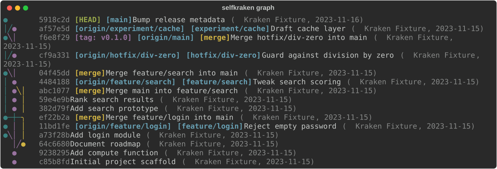

Branches (`skraken branches`):

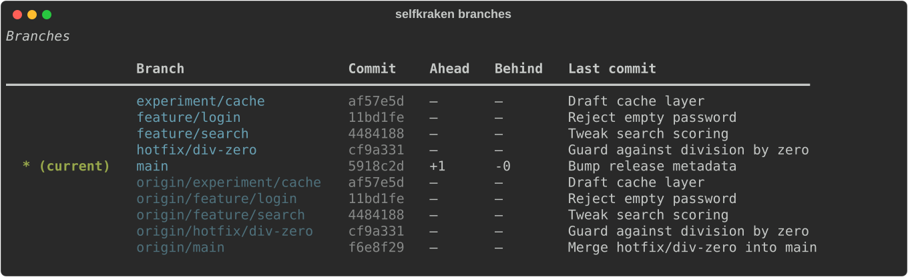

File tree with a proposal (`skraken tree --proposal`):

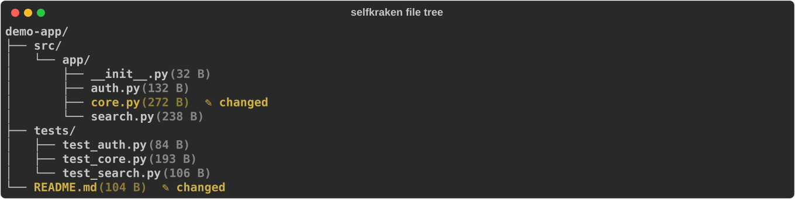

Propose and apply (`skraken propose` / `skraken apply`):

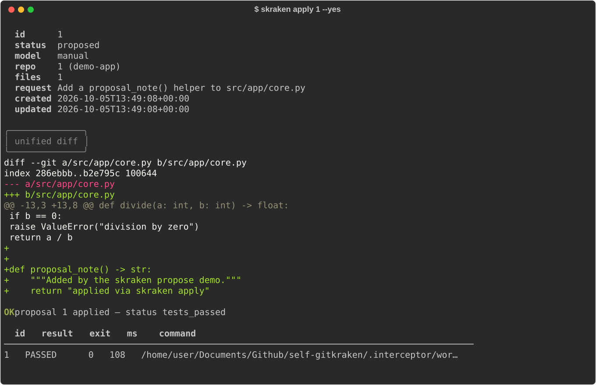

## Degraded mode (no model)

Leave `SK_LLM_BASE_URL` / `SK_LLM_MODEL` unset and everything still works
except model-generated proposals. You create proposals from a unified diff you
wrote or got elsewhere yourself:

```bash
skraken propose "guard against empty input" --diff-file my.patch
skraken show 7
skraken apply 7          # same pipeline: validate, apply, test, record
```

Indexing, search, apply, tests, revert, log, export/import, sample data — all
function without any model configured. `skraken doctor` tells you which mode
you are in.

## Model setup

selfkraken talks to **one OpenAI-compatible endpoint** (`POST
{SK_LLM_BASE_URL}/chat/completions`). Local Ollama is the typical choice; any
compatible server works. In `.env`:

```bash
SK_LLM_BASE_URL=http://localhost:11434/v1
SK_LLM_MODEL=qwen2.5-coder:7b
```

**What is sent to the model:** your request text plus up to `SK_MAX_CONTEXT_CHARS`
(default 12000) characters of repo file snippets selected from the index. So —
if you point `SK_LLM_BASE_URL` at a remote endpoint, **your code leaves the
machine** for that request. Keep it local if that matters to you.

Secret-like files (`.env`, `*.pem`, `*.key`, `id_rsa*`, `secrets.*`, `*.db`,
etc.) are **never indexed**, never sent, and never read as context. The API key
(when set) is only sent as a bearer token to your configured URL; it is never
printed, logged, or stored in the database.

## Commands

| Command | What it does |
|---|---|
| `skraken init [PATH]` | Register a git repo (`--test-cmd`, `--name`) |
| `skraken repos` | List registered repos |
| `skraken set-test CMD` | Set the test command for a repo |
| `skraken index` | (Re)index repo files; incremental by content hash |
| `skraken search QUERY` | Keyword search the index (FTS5) |
| `skraken propose REQUEST` | Ask the model for a diff; `--diff-file FILE` for manual proposals; `--file PATH` to include specific files as context; `--yes` skips confirmation |
| `skraken proposals [--status S]` | List proposals |
| `skraken show ID` | Show a proposal's diff and rationale |
| `skraken apply ID` | Apply with `git apply`, run tests, auto-rollback on failure (`--no-test`, `--commit`, `--keep-on-failure`) |
| `skraken reject ID` | Reject a proposed diff |
| `skraken revert ID` | Reverse an applied diff (`git apply -R`); does not rewrite git history |
| `skraken test` | Run the repo's test command and record the result |
| `skraken graph [--limit N] [--current-only] [--ascii]` | Commit graph with branch lanes, merges and tags — GitKraken-style, in the terminal (`--current-only` limits to the current branch, `--ascii` a plain-ASCII rendering) |
| `skraken branches` | Branch table with the current branch marked and ahead/behind counts |
| `skraken tree [--depth N] [--proposal ID]` | File tree (`--depth` bounds it); with `--proposal`, files that diff touches are marked `✎ changed` |
| `skraken log [--limit N]` | Audit log: every register/index/propose/apply/test/rollback/commit/reject/revert |
| `skraken export FILE` / `import FILE` | JSON portability (index not included; rebuild with `index`) |
| `skraken sample load [--kind calculator\|multibranch]` / `sample remove` | Labelled demo repos and proposals inside the data dir (see *Sample data*) |
| `skraken gui [--theme auto\|dark\|light] [--skip-checks]` | Open the native Qt desktop window — code shown in the vendored Monaco editor (needs the `gui` extra + one system library — see *Desktop GUI (Qt)*) |
| `skraken doctor` | Environment check: data path, DB, git, model mode |

Repo commands accept `--repo PATH` (default: the current directory, resolved to
the nearest registered repo).

## Permissions — what selfkraken reads and writes

- **Reads:** files in repos you register (tracked + untracked, minus
  secret-like and binary files) for indexing; the diff you apply.
- **Writes to your working tree:** only via `git apply` / `git apply -R` when you
  run `apply` / `revert`; `git add`/`commit` only if you pass `--commit`.
- **Runs:** your configured test command, as your user, in the repo directory
  (`shlex`-split, no shell).
- **Writes:** only to its data directory (SQLite DB, the `[SAMPLE]` demo repos
  and their bare remote) and files you explicitly name in `export`.
- **Network:** only to the configured `SK_LLM_BASE_URL`, plus whatever your own
  git remote does when you use git yourself — selfkraken never pushes/fetches.
- It never sends telemetry anywhere. It is the only client.

## Architecture

Modules: `config` (settings/.env), `db` (SQLite store), `gitops`/`diffs`
(git subprocess + diff validation), `indexer` (incremental file index +
context building), `llm` (OpenAI-compatible client), `runner` (test execution),
`workflow` (the UI-free core loop), `cli` (Typer front end), `portability`
(export/import), `sample` (demo data). The GUI adds `gui/app` (the window),
`gui/graph_widget` (the painted commit graph), `gui/models` (Qt item models),
`gui/theme` (the design tokens both the Qt stylesheet and the Monaco theme are
built from), `gui/monaco_view` + `gui/monaco_payload` (the embedded editor, its
request policy and its plain-text fallback) and `gui/preflight` (the checks that
run before Qt is imported). See
[docs/ARCHITECTURE.md](docs/ARCHITECTURE.md) for the module map, sequence
diagram, proposal state machine and security boundaries.

## Data location

Default: `~/.local/share/selfkraken/selfkraken.db` (or `$XDG_DATA_HOME/selfkraken`).
Override with `SK_DATA_DIR`. The `scripts/dev.sh` helper sets `SK_DATA_DIR=./.data`
so development data stays in the repo folder and is gitignored.

## Backup & restore

- Copy the database file while selfkraken is **not running**:
  `cp ~/.local/share/selfkraken/selfkraken.db backup/`
- Or use JSON portability:
  ```bash
  skraken export ~/backups/skraken-$(date +%F).json
  skraken import ~/backups/skraken-2026-10-05.json
  ```
  Export contains repos, proposals, test runs and the audit log. The file index
  is **not** exported (it is rebuildable, and it holds your file contents) —
  rebuild it after a restore with `skraken index`.

## Sample data

`skraken sample load` builds a labelled demo inside the data directory. Two
kinds are bundled, both tagged `[SAMPLE]` and both removed by one
`skraken sample remove`:

```bash
skraken sample load                   # calculator: 1 commit, 1 failing test, 1 fix proposal
skraken sample load --kind multibranch  # richer demo: a real multi-branch project
```

The calculator demo is `sample-repo`: `calc.py` with `add/sub/mul/div` (`div`
has no zero check) and `test_calc.py` whose suite goes green once you apply the
bundled proposal.

`--kind multibranch` builds `sample-multibranch` — a small python project
(`src/app` modules, real `pytest` tests that pass on `main`) with ~30 commits:
`main`, `feature/login`, `feature/search`, `feature/export`,
`hotfix/div-zero`, `release/0.2` and an unmerged `experiment/cache`, joined by
`--no-ff` merges (including one merge of `main` back into a feature) and tagged
`v0.1.0` and `v0.2.0`. Its fake remote is the sibling
`sample-multibranch-origin.git` **in the same data directory** — never a
generic `origin.git` dropped next to wherever you ran the command — and `main`
is 2 ahead / 1 behind it, so `skraken branches` shows real divergence. The
demo is registered and indexed on the way in, and gets one `[SAMPLE]`
proposal (a valid two-file patch that keeps the demo's tests green). Commit
dates and author identity are fixed, so the graph looks the same on every
machine. Loading again is a no-op (idempotent, and it never overwrites edits
you made in the demo); `skraken sample remove` deletes both demos' rows and
all three directories, and only after checking the `.selfkraken-sample`
ownership marker inside the data directory.

## Desktop GUI (Qt)

A native PySide6 desktop window for the same loop — no web server, no browser
window to manage. It is optional: the core install never requires PySide6, and
`skraken gui` tells you exactly how to get it if it is missing.

```bash
scripts/install.sh                 # installs '.[dev,gui]' (includes PySide6)
# or:  pip install -e '.[gui]'
.venv/bin/skraken gui              # dark or light, follows the system theme
.venv/bin/skraken gui --theme light
```

**The shell is one workspace, not a wall of panels.** A single 44px top bar
carries the wordmark, the page strip (**Graph · Proposals · Changes · Files ·
Branches · Review · Settings**), the repository selector and the model state;
one row of actions sits under it (**Add Repo**, **Index**, **Run Tests**,
**Export/Import**, **Sample**, **More**). Below that, the page is the whole
window — there are no side docks to resize or lose, and Settings lives at the
end of the strip the way it does in a browser.

Inside the pages: a GitKraken-style **commit graph** (painted lanes, merge
rings, ref badges like `HEAD`, `main ↑2`, `tag: v0.1.0`,
`feature/login ⇄ origin`), a **proposals** table with coloured status badges,
the **New proposal** form (request with live character counter and inline
validation, optional context files, optional *paste a unified diff* box for
degraded mode), and the **proposal detail** — rationale, Apply with *Run tests
/ Commit on success / Keep on failure*, Reject, Revert, and a collapsible
test-output tail. A bottom **activity log** shows every step, newest first.
Everything slow runs in worker threads; the window never freezes, and errors
come back as plain `Error:` text — never tracebacks.

### Themes and the Settings page

**Settings → Appearance** offers three choices, each with a swatch of what it
looks like:

| Choice | What it is |
| --- | --- |
| **Dark** (default) | Spartan Dark: near-black `#09090b`, zinc greys, one white accent, orange as the only warm note |
| **Light** | GitHub Light: white page, `#f6f8fa` wells, one blue (`#0969da`) |
| **System** | follows the desktop's own light/dark preference |

The choice applies the moment it is picked — no restart — and is remembered in
`gui-window.json` next to the database, so the window comes back in the theme
you left it in. The same page carries a **Type** card (the families in use) and
an **About** section: version, Python, Qt, and where the data and database live.

The interface is set in **Switzer**, with **IBM Plex Mono** for code, paths and
the activity log. Both travel with the package (and the GUI builds), so the
window looks the same on Linux, macOS and Windows instead of picking up whatever
the desktop's default font happens to be.

### The code viewer: Monaco, offline

Every place the GUI shows code — the proposal diff, a file opened from the tree,
test output — is rendered by **Monaco**, the editor that is in VS Code, embedded
in a `QWebEngineView` inside the same native window. The window is still a Qt
window; there is no local web server and nothing is ever fetched.

* **Vendored, pinned, hash-verified.** `scripts/vendor_monaco.py` downloads one
  npm tarball (version pinned in the script), checks it against npm's published
  `sha512` integrity, and commits the result under `selfkraken/gui/monaco/`.
  The app loads it from disk with `file://`; **no CDN, no network at runtime**.
  Re-run `python3.12 scripts/vendor_monaco.py --check` to prove what is on disk
  is what was pinned.
* **Nothing leaves the window.** The web view runs on an off-the-record profile
  with no cache, no cookies and no storage, and a request interceptor drops every
  request that is not a `file`/`qrc`/`data`/`blob` inside the vendored folder —
  so neither Monaco nor the *contents of your repository* can open a connection
  or read a file the app did not choose to show. Popups, clipboard access and
  navigation away from the page are off; the page itself declares a CSP with
  `connect-src 'none'`.
* **Read-only.** The editor is for reviewing, not editing; it never writes a file.
* **Diff that fits the pane.** A proposal's diff is split per file: a compact
  strip lists the touched files with their `+N/−M` counts, and clicking one shows
  that file's before/after — `original` is `git show HEAD:<path>`, `modified` is
  that content with the file's own chunk applied **in a temp directory** by
  `git apply`, so your working tree is never touched to draw a picture. Side by
  side when the pane is wide enough, inline when it is not, with a toggle that
  overrides the choice.
* **Files as tabs.** Double-clicking a file in the tree opens it read-only in a
  closable tab beside Graph / Proposals / Changes, with the lines the selected
  proposal touches marked — numbered on the side you are actually looking at
  (before the patch when it is still only proposed).
* **It matches the theme.** The Monaco theme is generated from the same palette
  tokens the Qt widgets paint with, so the editor's background, selection and
  added/removed colours are the diff colours everywhere else.

**Fallback.** If QtWebEngine cannot start, if the vendored files are missing, or
if `SK_GUI_NO_WEBENGINE=1` is set, the GUI uses its own plain-text diff viewer
(the same highlighting, `QPlainTextEdit`-based) and says so in one muted line —
*plain viewer (Monaco unavailable)*. Offscreen (the test suite, and the
screenshots below) always takes this path, because QtWebEngine cannot paint
there; `docs/screenshots/gui-monaco.png` and `gui-file.png` are captured from a
real display with Monaco running.

Monaco Editor is MIT-licensed, version **0.57.0**, vendored in this repository —
see `selfkraken/gui/monaco/LICENSE` and
`selfkraken/gui/monaco/ThirdPartyNotices.txt`.

Commit graph with lanes, merges and refs:

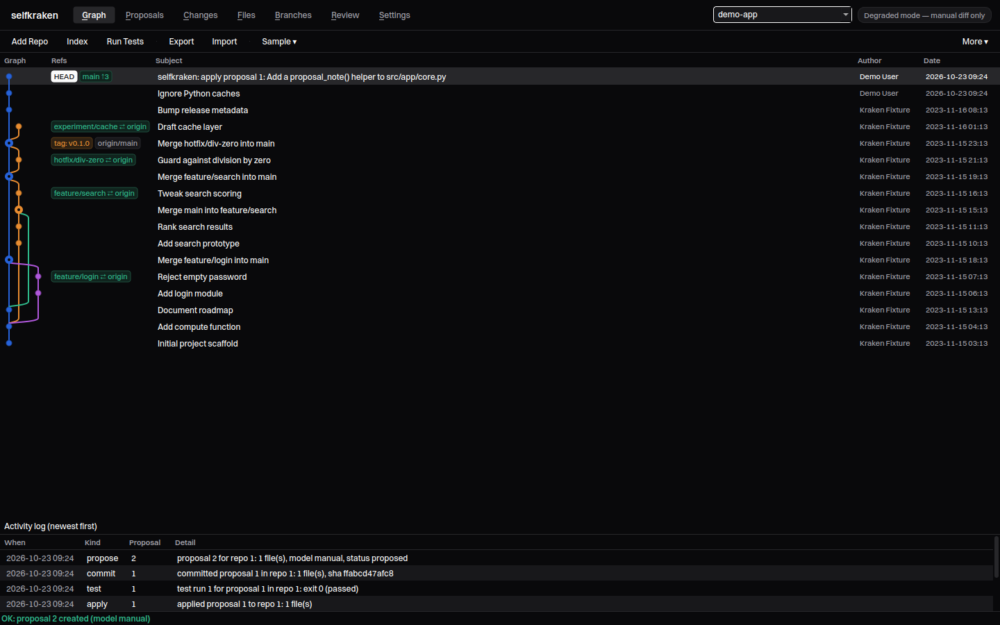

Proposal review: the diff centre-stage, apply options, test result (offscreen —
plain viewer, the fallback):

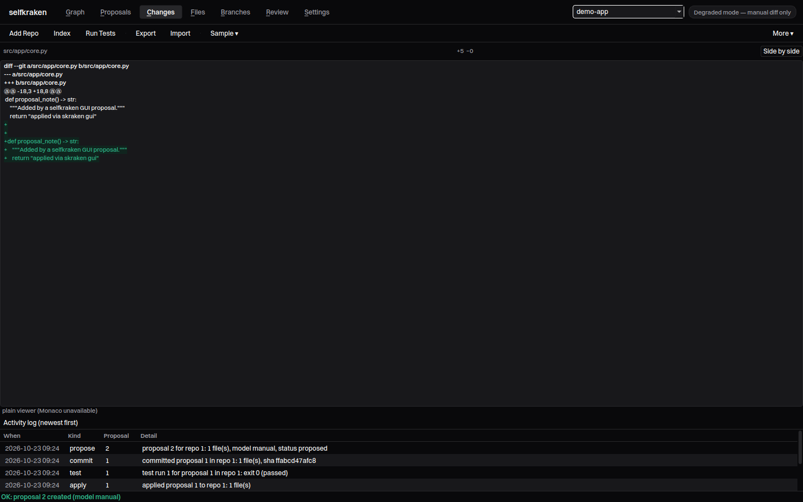

The same proposal with Monaco running (captured on a real display):

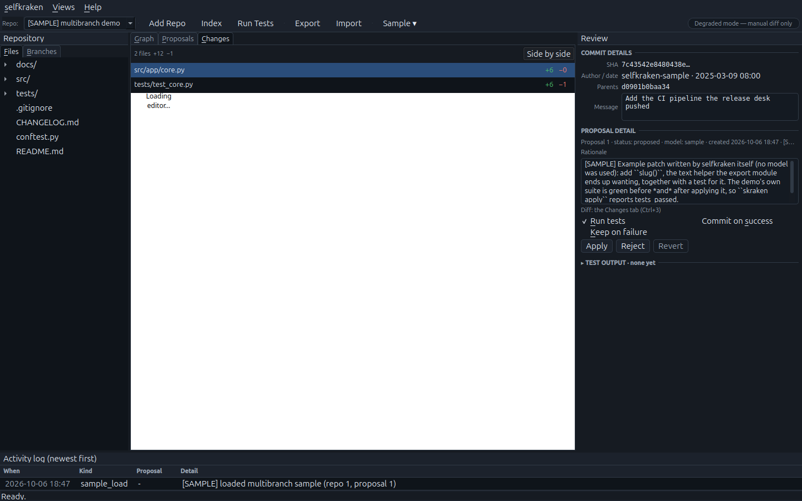

A file from the tree, open read-only in its own tab (Monaco, real display):

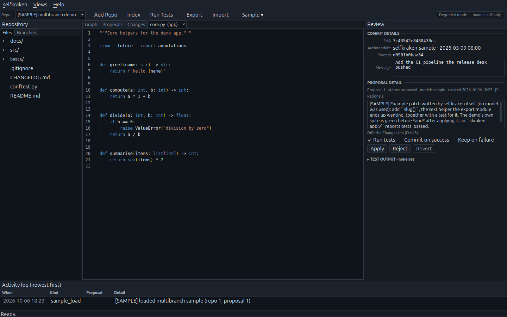

Empty state with guidance:

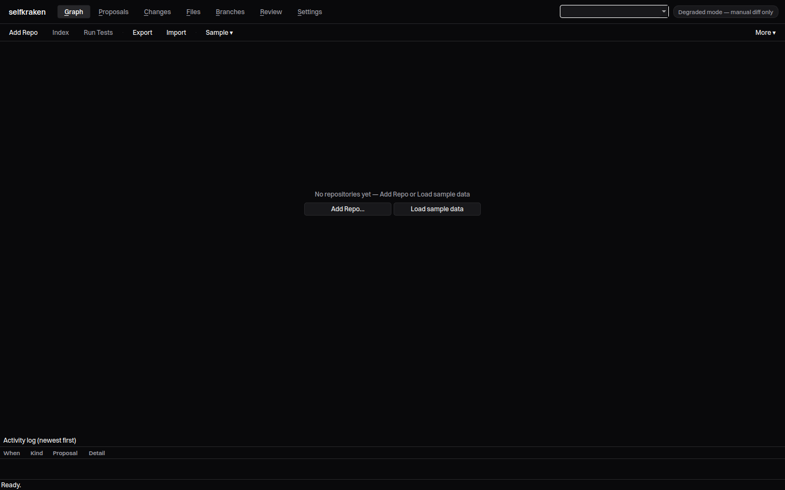

Light theme:

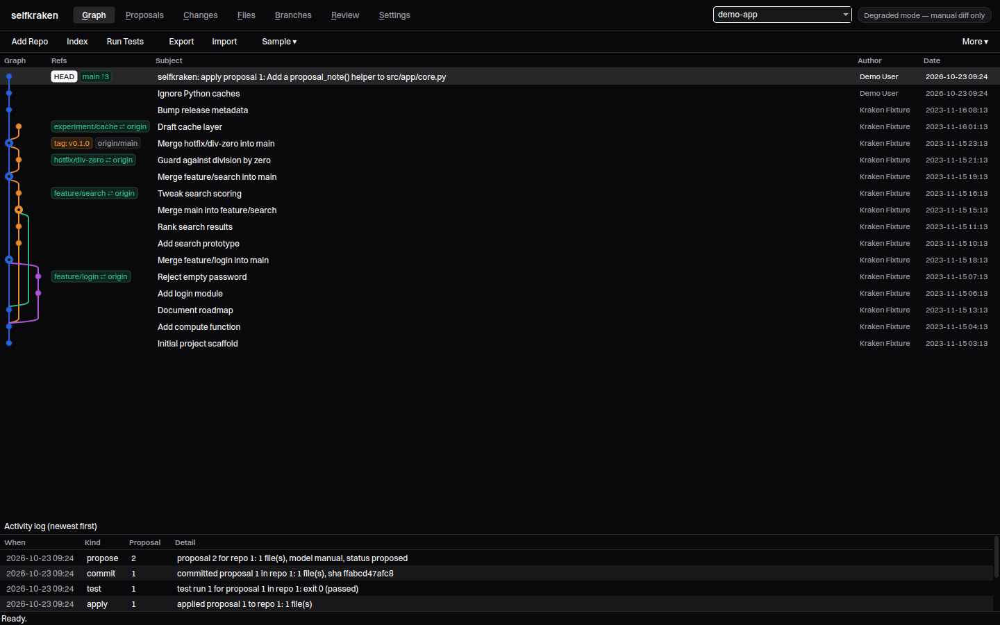

Settings → Appearance, where the theme is chosen (dark and light):


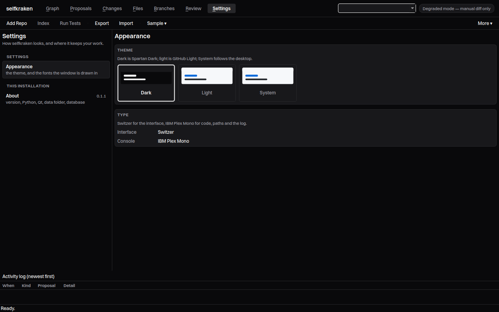

Regenerate the offscreen screenshots anytime with
`.venv/bin/python scripts/gui_screenshots.py` (offscreen Qt, throwaway data).
The two Monaco pictures need a desktop session, because QtWebEngine cannot paint
offscreen: `.venv/bin/python scripts/gui_monaco_shot.py`. Both grab the app's own
window, never the screen.

### System requirements for the GUI

One thing `pip` cannot install: from Qt 6.5 on, the xcb (X11) platform plugin
needs the **system** library `libxcb-cursor0`. Without it the window never
opens — Qt aborts the process with a core dump:

```
qt.qpa.plugin: From 6.5.0, xcb-cursor0 or libxcb-cursor0 is needed to load the Qt xcb platform plugin.
qt.qpa.plugin: Could not load the Qt platform plugin "xcb" in "" even though it was found.
Aborted (core dumped)
```

`skraken gui` now checks the environment **before** importing Qt and prints
the fix instead of crashing: it refuses to start when no display is available
(tell you to run it from a desktop session), when `libxcb-cursor0` cannot be
loaded, and — as a back-stop for anything the checks cannot see — a throwaway
subprocess first proves a `QApplication` really comes up on your display.
Install the library once per machine:

```bash
sudo apt install libxcb-cursor0     # Debian / Ubuntu
sudo dnf install xcb-util-cursor    # Fedora
sudo pacman -S xcb-util-cursor      # Arch
```

On a Wayland session Qt is automatically told to prefer the Wayland plugin;
`--skip-checks` bypasses the guards if you know better than they do. The
**CLI needs none of this**: every `skraken` command except `gui` works
headless with no system packages, and the test suite runs Qt offscreen.

The embedded editor adds no pip dependency — `QWebEngineWidgets` ships in the
`PySide6` package itself (`PySide6-Addons`) — and no system package beyond what
Qt already needs. If it cannot start on your machine, the GUI notices and shows
its plain-text viewer instead of failing; set `SK_GUI_NO_WEBENGINE=1` to choose
that viewer deliberately (and `SK_GUI_DEBUG=1` to see the editor's console
output and why it fell back).

### Keyboard shortcuts

| Shortcut | Action |
|---|---|
| `Ctrl+1` | Show the Graph tab |
| `Ctrl+2` | Show the Proposals tab |
| `Ctrl+3` | Show the Changes tab (the proposal diff) |
| `Ctrl+N` | New proposal (focus and clear the request form) |
| `Ctrl+Enter` | Submit the proposal request |
| `Ctrl+I` | Index the selected repository |
| `Ctrl+T` | Run the repository's tests |
| `F5` | Refresh everything from the database |
| `F1` | Keyboard-shortcuts help |
| `Arrow keys` | Navigate the graph and tables |
| `Enter` / double-click | Open the selected file in a tab (Files tree) |
| `Ctrl+Q` | Quit |

Accessibility: every control has an accessible name, form labels use buddies
and mnemonics, status is always a text label (`OK:`, `Error:`, `PASSED`,
`✎ changed`) and never colour alone, both palettes are WCAG-AA contrast,
and the graph is fully keyboard-navigable.

## Accessibility

- Keyboard-only by design — it is a CLI.
- Status is always a **text label** (`OK`, `FAILED`, `Error:`, `[SAMPLE]`),
  never conveyed by color alone.
- Respects `NO_COLOR` (and non-TTY output loses color automatically).
- Output is plain text suitable for screen readers; loading spinners appear
  only on an interactive TTY.

## Privacy

Single-user and local. No telemetry, no analytics, no ads, no accounts, no
background services. The only outbound request is the one you trigger, to the
model URL you configured. Your `.env` key stays on your machine. The GUI's code
editor is vendored into the package and pinned by hash — it loads from disk, is
blocked by a request interceptor from reaching anything else, and never talks to
a CDN.

## Scripts

| Script | Purpose |
|---|---|
| `scripts/install.sh` | Create `.venv` (python3.12), install `.[dev,gui]`, make `.env` (600) |
| `scripts/dev.sh ...` | Dev mode: `SK_DATA_DIR=./.data`, runs `doctor` then passes args to `skraken` |
| `scripts/test.sh ...` | Run pytest in `.venv` |
| `scripts/build.sh` | Build sdist + wheel into `dist/` |
| `scripts/run.sh ...` | Install the built wheel into `.venv-run` and run it (default data dir) |
| `scripts/screenshots.sh ...` | Regenerate the README screenshots (`python scripts/screenshots.py --out docs/screenshots`) |
| `scripts/vendor_monaco.py` | Fetch, hash-verify, prune and vendor the Monaco editor into `selfkraken/gui/monaco/` (`--check` verifies what is committed) |
| `scripts/gui_screenshots.py` | Regenerate the offscreen GUI screenshots (shows the plain-viewer fallback) |
| `scripts/gui_monaco_shot.py` | Regenerate `gui-monaco.png` / `gui-file.png` — needs a desktop session, captures the app window only |

## Testing

Unit tests cover config, DB, portability, sample data, git/diff handling,
indexing, the LLM client and the runner; plus a workflow, CLI and end-to-end
smoke test that exercises the full loop (init → index → propose → apply →
log) against a **local HTTP stub** of an OpenAI-compatible endpoint — no real
model, no network.

```bash
scripts/test.sh            # everything
```

## Limitations (honest list)

- The test command is split with `shlex` and run without a shell — no pipes,
  `&&`, globs or redirects in `--test-cmd`. Wrap those in a script.
- Search is keyword/FTS5, not embeddings or semantic.
- Diff quality depends entirely on your model and context size; a bad model
  gives bad diffs, and `apply` only guarantees the diff applies and your tests
  decide the rest.
- `revert` reverses the diff in the working tree; it does not rewrite git
  history (if you used `--commit`, the commit stays; revert makes an inverse
  change to undo its effect).
- One model at a time, one endpoint, configured by environment variables.
- No merge-conflict UI, no rebase UI — the GUI covers the core loop, not all
  of git.
- Context is truncated at `SK_MAX_CONTEXT_CHARS`; big refactors across many
  files will not fit in one request.
