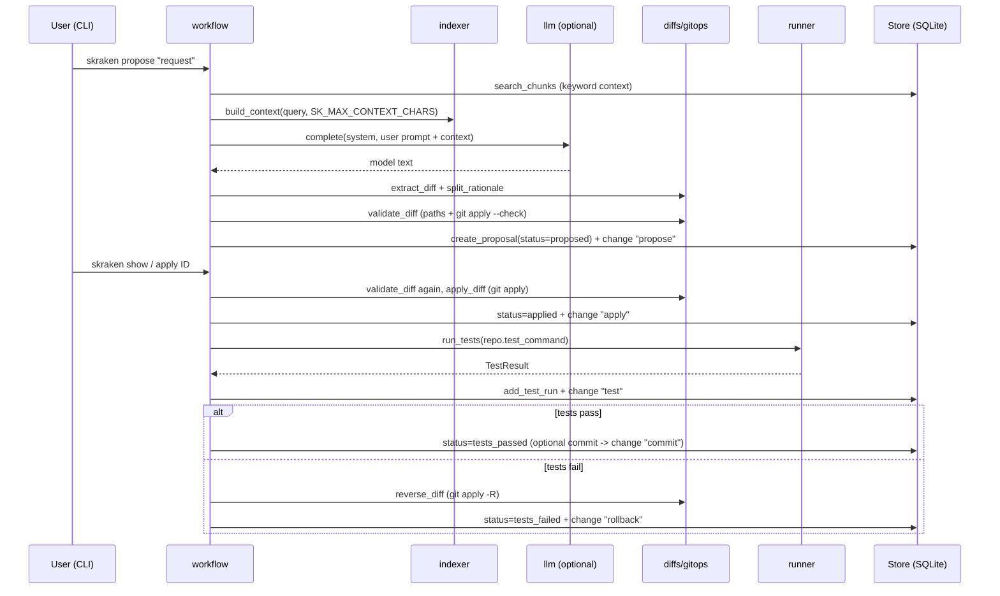
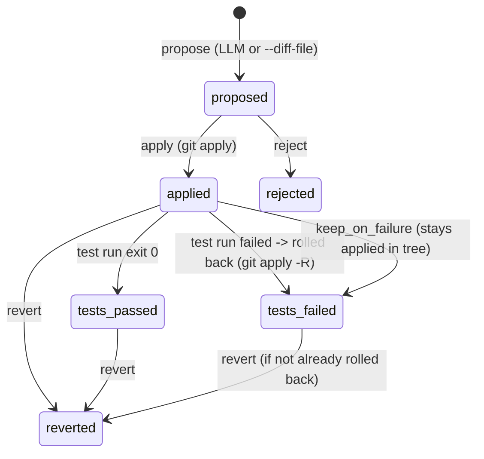

# selfkraken architecture

A private, single-user, repository-local Git assistant. Stack: Python 3.12,
Typer (CLI), stdlib `sqlite3` (storage), stdlib `urllib.request` (model HTTP),
`python-dotenv` (config), `rich` (terminal output, via Typer). Everything
below is what the build contract specifies — nothing more.

## Module map

| Module | Responsibility |
|---|---|
| `selfkraken/config.py` | `Settings` dataclass; loads `.env` (python-dotenv, real env wins); validates vars (`ValidationError` names the variable, never the value); `llm_enabled` property; `redact()` strips the API key from any text. The key field is `repr=False` — never in repr/str/output. |
| `selfkraken/db.py` | `Store`: opens/migrates SQLite at `data_dir/selfkraken.db` (`foreign_keys=ON`, `journal_mode=WAL`, `meta.schema_version = 1`); typed dataclasses (`Repo`, `Proposal`, `TestRun`, `Change`, `Chunk`); CRUD for repos, file index + FTS5 chunk search (plain-table `LIKE` fallback), proposals, test runs, append-only audit log; `delete_sample_data()`. |
| `selfkraken/gitops.py` | Thin `git` wrappers via `subprocess.run([...], shell=False, ...)` with timeouts: `is_git_repo`, `repo_root`, `head_sha`, `changed_paths`, `commit_paths`. Failures raise `GitError` with stderr's first line. |
| `selfkraken/diffs.py` | Diff plumbing: `extract_diff` (from a fenced model reply or raw text), `touched_paths`, `validate_diff` (size/path/containment checks + `git apply --check`), `apply_diff`, `reverse_diff`, `can_reverse`. Diffs are passed to git on stdin. |
| `selfkraken/indexer.py` | Incremental repo index: `git ls-files` (tracked + untracked, honoring `.gitignore`), SHA-256 change detection, skips secret-pattern/binary/oversized files, 60-line chunks into FTS5; `build_context()` assembles prompt context (explicit `--file` paths first, then search hits) truncated to `max_chars`. |
| `selfkraken/llm.py` | `OpenAICompatibleClient` — POSTs `{base_url}/chat/completions` via `urllib.request`, bearer key only when configured; errors never contain the key. `make_client(settings)` → `None` when model not configured (degraded mode). `SYSTEM_PROMPT` demands rationale + exactly one ```diff block; `split_rationale()` for storage. |
| `selfkraken/runner.py` | `run_tests()`: `shlex.split` the configured command, `shell=False`, cwd = repo, merged output tail (4000 chars), timeout → exit 124, missing executable → 127. |
| `selfkraken/workflow.py` | The core loop, UI-free: `register_repo`, `resolve_repo`, `propose` (LLM or manual `--diff-file`), `apply_proposal` (apply → test → keep/rollback → optional commit), `reject_proposal`, `revert_proposal`, `run_repo_tests`. Every step records to the audit log. |
| `selfkraken/graph.py` | Builds the commit-graph data from git (log walk: commits, parents, branch lanes, merges, tags), for the `graph` / `branches` views. Git via `gitops` (no shell, timeouts). |
| `selfkraken/views.py` | Terminal rendering of the visualisation commands: commit graph with branch lanes (`--limit`, `--current-only`, `--ascii` fallback), branch table (current marker, ahead/behind), file tree (`--depth`, proposal-touched files marked `✎ changed`). |
| `selfkraken/cli.py` | Typer app (`skraken`). Thin layer over workflow, store and the graph/views modules (visualisation commands `graph`, `branches`, `tree`). UX states: empty/loading/validation/success/failure with text labels (`OK`, `FAILED`, `Error:`), never color alone; respects `NO_COLOR`; `SKError` → message + exit 1, no tracebacks; confirmation before `apply` unless `--yes`; `doctor` reports environment. |
| `selfkraken/portability.py` | `export_data` / `import_data`: JSON v1 with repos, proposals, test runs, changes (file index excluded — rebuildable, contains contents); strict validation, id remapping, single transaction. |
| `selfkraken/sample.py` | `[SAMPLE]` demo repo (git-init'd calculator + failing-div test suite) and one sample proposal in `data_dir/sample-repo`; load is idempotent; `remove_sample` cleans DB rows + directory. |
| `selfkraken/errors.py` | Exception hierarchy (all subclass `SKError`): `ValidationError`, `NotFoundError`, `GitError`, `LLMUnavailable`, `LLMError`. |

## Core-loop sequence



Manual mode (`--diff-file`) enters the same pipeline after skipping the
index/LLM steps: the given text goes straight to `extract_diff` →
`validate_diff` → stored with model `manual`.

## Proposal state machine



Notes: `tests_failed` from an auto-rollback means the working tree was
restored; with `--keep-on-failure` the change remains applied. `revert` only
reverses the diff — it never rewrites git history. `apply` and `revert` are
only legal from the states shown; anything else is a `ValidationError`.

## Database schema (summary)

SQLite in `settings.db_path`; all timestamps UTC ISO-8601.

| Table | Purpose | Key fields |
|---|---|---|
| `meta` | schema version | `schema_version = 1` |
| `repos` | registered repos | `path` UNIQUE (resolved), `name`, `test_command`, `is_sample` |
| `files` | per-file index rows | `(repo_id, path)` UNIQUE, `sha` (change detection), `size`, `indexed_at` |
| `chunks` | FTS5 virtual table (LIKE fallback) | `repo_id`, `path`, `start_line`, `content` |
| `proposals` | diff proposals | `request`, `model`, `diff`, `rationale`, `status` ∈ `PROPOSAL_STATUSES`, `is_sample` |
| `test_runs` | recorded test executions | `command`, `exit_code`, `passed`, `duration_ms`, `output_tail` |
| `changes` | append-only audit log | `kind` ∈ `CHANGE_KINDS`, `detail` (metadata only, never file contents) |

`repo_id` references cascade on delete; `proposal_id` on test runs/changes
nulls out.

## Security boundaries

- **Diff validation before touching the tree.** A proposal's diff must be
  non-empty, ≤ 200 KB, contain no NUL bytes, reference only relative paths
  with no `..`, never under `.git/`, resolving inside the registered repo —
  and pass `git apply --check` before it is ever applied (checked again at
  apply time).
- **Secret files never indexed.** `SECRET_PATTERNS` (`.env`, `*.pem`, `*.key`,
  `id_rsa*`, `*.p12`, `*.pfx`, `secrets.*`, `*.sqlite`, `*.db`) are skipped by
  the indexer, cannot be passed as `--file` context, and therefore never reach
  the model or the database.
- **No shell.** Every subprocess (`git`, the test command) runs as an argv
  list with `shell=False`, captured output, and a timeout. The test command is
  `shlex`-split, not interpreted.
- **Key hygiene.** `SK_LLM_API_KEY` is `repr=False`, only ever sent as a
  bearer header to the configured URL, redacted (`***`) from any message text,
  and `doctor` shows it only as "set"/"not set". Logging carries metadata
  (counts, ids, paths) — never contents or keys.
- **Bounded context.** At most `SK_MAX_CONTEXT_CHARS` of repo snippets per
  request; import files capped at 50 MB with strict schema validation in one
  transaction.
- **Local by default.** The only network peer is the user-configured
  `SK_LLM_BASE_URL`. With no model configured (degraded mode) selfkraken
  makes no outbound requests at all.
